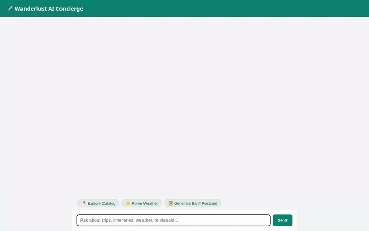

# Wanderlust AI — Travel Concierge Agent

An intelligent, agent-first travel assistant built with Google's **Agent Development Kit (ADK)**, **Vertex AI Agent Engine**, and **Gemini 2.5 Flash**. Wanderlust AI helps users explore destinations, inspect real-time weather, generate custom destination postcards, and create personalized travel itineraries.



---

## 🌟 Features Implemented

- **Vertex AI Memory Bank**: Persists user travel preferences, budget styles, and past choices across sessions.
- **Firestore Database Integration**: Live catalog lookups for featured destinations (`banff-canada`, `kyoto-japan`, `rome-italy`, `reykjavik-iceland`).
- **Open-Meteo Weather Tool**: Live weather retrieval for any destination globally.
- **Imagen 3 Postcard Generation**: Custom postcard image generation uploaded directly to Google Cloud Storage.
- **Rich A2UI Cards**: Native display UI for cards, lists, headers, and images rendered seamlessly in both the ADK Dev UI and custom Web Chat UI.
- **FastAPI Proxy + Cloud Run Frontend**: A secure, same-origin chat UI proxy that communicates with Vertex AI Agent Engine using the A2A v1.x protocol.

---

## 🏗️ Architecture

```
┌─────────────────────────────────┐
│     Browser / User Interface    │
└────────────────┬────────────────┘
                 │
                 ▼
┌─────────────────────────────────┐
│      Cloud Run FastAPI Proxy    │
│      (frontend/main.py)         │
└────────────────┬────────────────┘
                 │  A2A Protocol (JSON-RPC)
                 ▼
┌─────────────────────────────────┐
│  Vertex AI Agent Engine Backend │
│  (Reasoning Engine / ADK App)   │
└────────┬───────────────┬────────┘
         │               │
         ▼               ▼
 ┌───────────────┐ ┌─────────────┐
 │ Vertex AI     │ │ Firestore & │
 │ Memory Bank   │ │ Cloud Storage│
 └───────────────┘ └─────────────┘
```

---

## 🚀 Local Development Setup

### 1. Backend Setup
```bash
# Install dependencies
uv sync

# Set GCP environment variables
export GOOGLE_CLOUD_PROJECT="qwiklabs-gcp-04-15689d1f930e"
export GOOGLE_CLOUD_REGION="us-east1"

# Run ADK Web Dev UI locally
adk web
```

### 2. Frontend Setup
```bash
cd frontend

# Install frontend proxy dependencies
pip install -r requirements.txt

# Run the proxy locally (connected to deployed Agent Engine)
export AGENT_ENGINE_RESOURCE_NAME="projects/109757236593/locations/us-east1/reasoningEngines/1463474165825667072"
export AGENT_DIRECTORY="wanderlust_planner"

python main.py
```
Open [http://localhost:8080](http://localhost:8080) to chat with your agent locally!

---

## 🌐 Cloud Run Deployment

To deploy the frontend proxy to Cloud Run:
```bash
gcloud run deploy wanderlust-frontend \
  --source frontend \
  --project qwiklabs-gcp-04-15689d1f930e \
  --region us-east1 \
  --allow-unauthenticated \
  --set-env-vars="AGENT_ENGINE_RESOURCE_NAME=projects/109757236593/locations/us-east1/reasoningEngines/1463474165825667072,AGENT_DIRECTORY=wanderlust_planner"
```

---

## 📹 Recording a Demo
To record a fresh screen-capture demo of your agent:
```bash
node .agents/skills/record-demo/record-agent.js \
  -q "Show destinations in catalog" \
  -q "What is the weather in Rome?" \
  -o agent_demo.webm
```
To convert to a looping GIF for GitHub:
```bash
ffmpeg -y -i agent_demo.webm -vf "fps=10,scale=720:-1:flags=lanczos,split[s0][s1];[s0]palettegen[p];[s1][p]paletteuse" demo.gif
```
